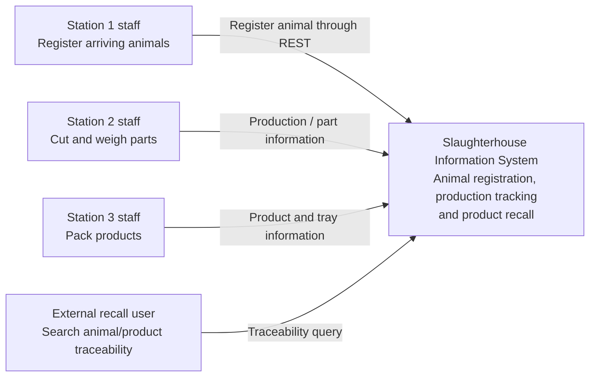
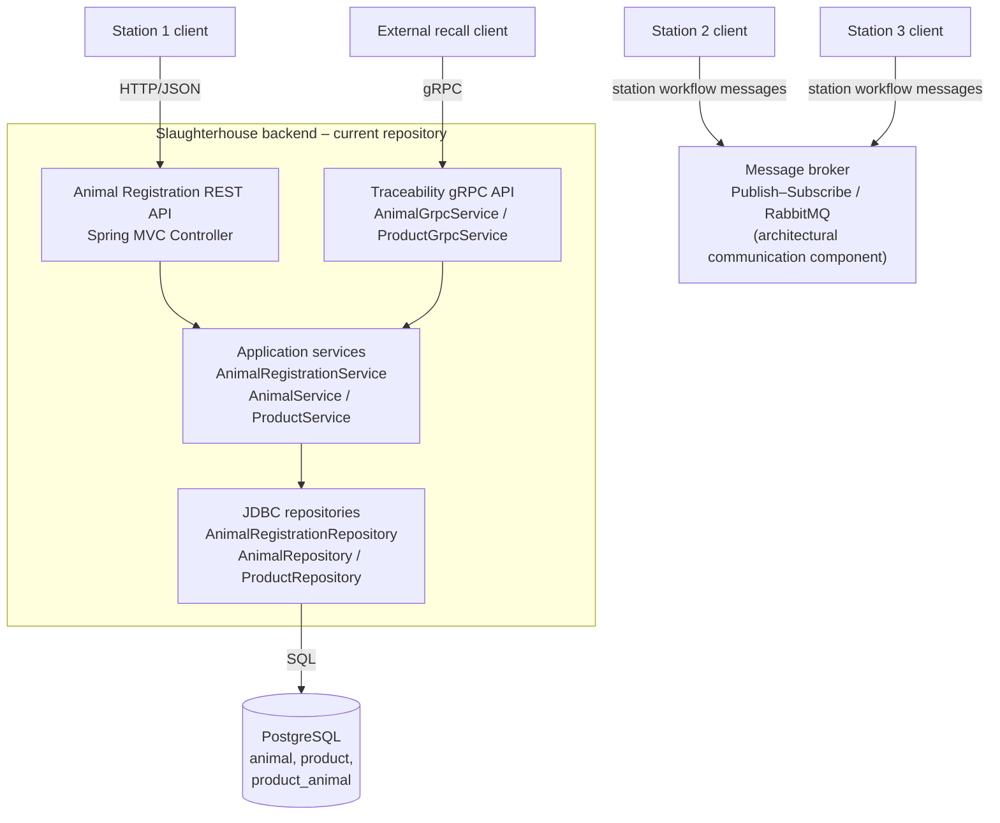
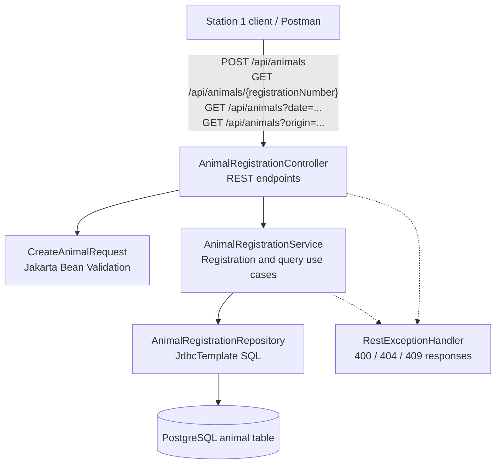

# PRO3 Architecture Update – Part 3

This document updates the C4 views for the Part 3 Animal Registration REST service.

> Scope note: The supplied repository contains the Part 2 Spring Boot/gRPC implementation, PostgreSQL schema and sample data. It does not contain the original Part 1 diagrams. The C1/C2 views below therefore preserve the assignment's slaughterhouse context and the previously discussed goal of independent stations with indirect messaging, while distinguishing that target architecture from what is implemented in this repository today.

## C1 – System Context View

The Part 3 change adds the animal-registration capability used by Station 1. The external recall user continues to use the traceability capability introduced in Part 2.

## C2 – Container View

### Communication

- Station 1 uses synchronous HTTP/JSON requests to register an animal and read registration data.
- Part 2 traceability queries use gRPC.
- The publish-subscribe/message-broker communication remains the architectural approach for decoupling station workflows, so a temporary network failure between stations does not have to stop every station.
- The supplied repository does **not** currently contain RabbitMQ producer/consumer code. The broker in this view represents the wider assignment architecture, not a claim that RabbitMQ integration has already been implemented.
- In the current codebase, REST and gRPC are hosted by the same Spring Boot application and use the same PostgreSQL database. This is a practical implementation choice; it is not yet a separately deployed microservice.

## C3 – Component View: Animal Registration REST API

### Component responsibilities

| Component | Responsibility |
|---|---|
| `AnimalRegistrationController` | Exposes REST endpoints and translates HTTP requests into service calls |
| `CreateAnimalRequest` | Carries registration input and validates required fields |
| `AnimalRegistrationService` | Implements registration and the three required lookup use cases |
| `AnimalRegistrationRepository` | Reads and writes animal registration data using `JdbcTemplate` |
| `AnimalRegistration` | Represents the complete animal registration returned by the API |
| `RestExceptionHandler` | Maps validation, missing-animal and duplicate-registration errors to HTTP responses |

### Database changes

The existing `animal.registration_number` primary key is retained. Part 3 adds:

- `arrival_date DATE`
- `weight NUMERIC(10, 2)`
- `origin VARCHAR(255)`

The existing `product_animal.registration_number` foreign key remains connected to `animal.registration_number`. This preserves the Part 2 animal-to-product traceability relationship.

### Implemented versus architectural target

| Capability | Status in supplied code |
|---|---|
| Animal registration REST API | Implemented in this Part 3 update |
| Read animal by registration number | Implemented |
| Read animals by arrival date | Implemented |
| Read animals by origin farm | Implemented |
| PostgreSQL persistence | Implemented using existing `JdbcTemplate` setup |
| Part 2 gRPC traceability | Existing code retained |
| RabbitMQ station messaging | Not implemented in this repository snapshot |
| Independently deployed station microservices | Not implemented in this repository snapshot |
